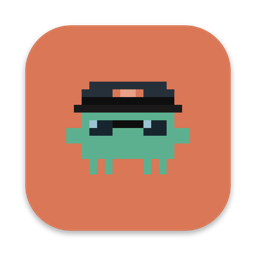
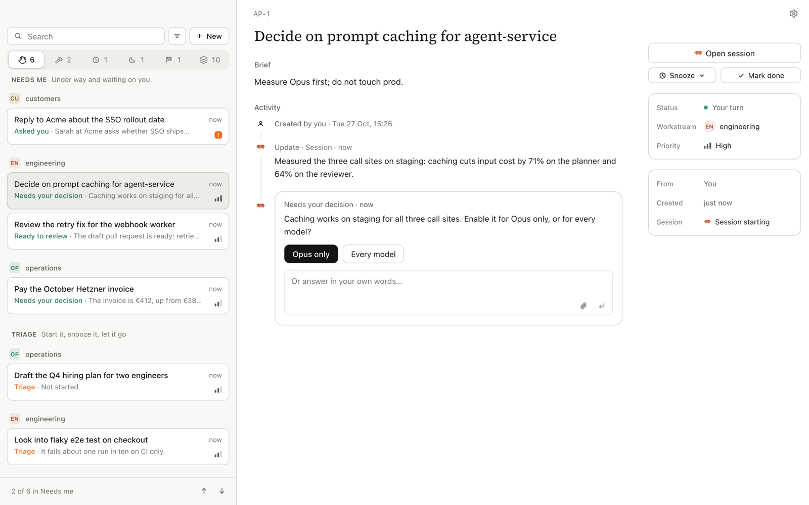
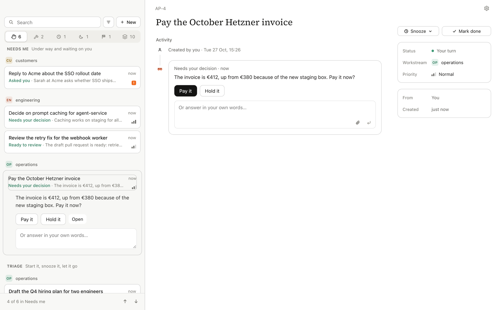

<p align="center">
  
</p>

<h1 align="center">Autopilot for Claude</h1>

<p align="center">
  <b>One queue for everything that needs you.</b><br />
  Autopilot watches your inbox, Slack, GitHub and Linear, lines up what needs you, and has<br />
  Claude Code prepare the work: the reply drafted, the fix on a branch, the facts for a decision.<br />
  You decide. It never sends, merges or deletes on its own.
</p>

<p align="center">
  <a href="docs/GUIDE.md"><b>Read the guide</b></a> ·
  <a href="#get-started">Get started</a> ·
  <a href="docs/RUNNING.md">Install on a Mac</a> ·
  <a href="#the-iphone">The iPhone app</a>
</p>

<p align="center">
  
</p>

## Why

Your work arrives in five places, and half of it is the same kind of chore: read the thread, look
something up, draft the answer. Autopilot does that half. Each morning you open one list, already
in order, where every row says what it wants from you, and most of them take a single click.

## How it works

|  |  |  |
| --- | --- | --- |
| 📡 **Signals listen** | 📥 **One queue** | 🧑‍✈️ **Sessions prepare** |
| Gmail, Slack, GitHub, Linear and more are read on a schedule. What needs you becomes a task, routed to the right workstream. Nothing old is filed. | **Needs me** holds what waits on your answer, each row saying what it wants: *Needs your decision*, *Ready to review*. Under it, **Triage**: what came in and has not started. | Say go and a Claude Code session starts in its own worktree, with Remote Control. It drafts, codes and digs, then hands back on the task. Answer it from the Mac or your phone. |

## A task reads like a conversation



The session posts what it found and what it needs. You pick an option or answer in your own words,
and the answer reaches the session while it waits. Press <kbd>Space</kbd> on a row to answer it
without even opening the task. Screenshots it attaches show as pictures; drafts and documents read
in place.

## What you get

- ✋ **Needs me, in order.** Urgent first, then whose turn it is. A task moves up only when
  something changed that needs you, never because it got old.
- 🧭 **Triage on its own.** New things wait under Triage until you start, snooze or drop them, so
  they never bury a session that is waiting on you.
- ⌨️ **Keyboard first.** <kbd>⌃⌥Space</kbd> files a new task from any app, with the text you
  selected as its brief; <kbd>↑</kbd> <kbd>↓</kbd> move through the list, <kbd>⌥1</kbd>–<kbd>⌥9</kbd>
  jump to a task.
- 📱 **On your phone too.** The same queue on the iPhone, over Tailscale, and it keeps working
  offline: answers wait on the phone and send when your Mac is back.
- 🔒 **Yours.** It runs on your Mac. The phone talks only to your Mac, pinned to its own
  certificate. Every session prepares; nothing leaves without you.

## Get started

You need a Mac with [Claude Code](https://claude.com/claude-code) signed in, Node 24 and pnpm.

```sh
git clone https://github.com/eddial/autopilot-for-claude
cd autopilot-for-claude
pnpm install
pnpm --filter @autopilot/desktop package --install
```

Open **Autopilot** from your Applications folder. Set up takes a few minutes and files nothing
until the last step:

1. **Get ready**: checks Claude Code and your connectors.
2. **Sources**: a signal for each source your connectors can read.
3. **Workstreams**: your areas of work, suggested from what you have.
4. **Preview**: what each signal would have filed yesterday.
5. **Switch on**: signals start from now.

Then read [the guide](docs/GUIDE.md): ten minutes, and you know every key.

## The iPhone

The iPhone app shows the same queue, with native tabs, and works one-handed or on an open iPhone
Duo with the list and the task side by side. It pairs with your Mac over
[Tailscale](https://tailscale.com) by scanning a code in **Settings → Devices**. For now it is
built from source with Xcode; [RUNNING.md](docs/RUNNING.md) shows how.

## Status

In daily use by its author: the server, the Mac app and the iPhone app work end to end. Private
until the first usable release; then open source under Apache-2.0.

## Documentation

| | Document | What it covers |
| --- | --- | --- |
| 📘 | [Guide](docs/GUIDE.md) | Using it: setting up, the queue and its order, tasks and sessions, the keys, the iPhone |
| 🛠️ | [Running](docs/RUNNING.md) | Installing and checking it on a Mac, the iPhone build, the CLI |
| 🎨 | [Design](docs/DESIGN.md) | The design tokens and building blocks both apps draw with, and the iPhone Duo |
| 🧭 | [Product](docs/PRODUCT.md) | The experience: the queue, the attention model, tasks as updates, onboarding, the screens, the pilot |
| 🏗️ | [Architecture](docs/ARCHITECTURE.md) | Roles, how it runs on the Mac and reaches the iPhone, the stack, storage, write-back, security |
| 🔌 | [API](docs/API.md) | The contract: entities, commands, changes, update kinds, access scopes, and the MCP tools any agent can use |
| 🗺️ | [Plan](docs/PLAN.md) | Phases with exit criteria and open questions |

Design concept: https://claude.ai/artifact/NaVZFaCJWSh8VT5aaaFoSP

<details>
<summary><b>Under the hood</b></summary>

One TypeScript server (SQLite, oRPC) owns tasks, runs the tick (signals, watchers, health, the
nightly routing review) and starts Claude Code sessions with `--remote-control`. Every app is only
a client of its versioned API: an Electron app on the Mac, an Expo app on the iPhone. On the Mac the
app installs the server as a background agent and talks to it over a local socket; the iPhone pairs
with that Mac and connects over the local network or Tailscale, and keeps taking input while the Mac
is unreachable. Sessions write back through Autopilot's own MCP server, with access scoped per
caller. A task is a short conversation of typed updates, and the queue ranks tasks by whose turn it
is, so the top row is always something to act on.

It is the successor of `autopilot-for-linear`, which used Linear as its control plane; this one has
its own.

| Decision | Choice | Why |
| --- | --- | --- |
| Control plane | Autopilot's own server, not Linear | Linear stays a signal source (team tickets), not where you steer |
| Audience | You first, then anyone; open source later | Private until the first usable release; Apache-2.0 |
| Language | TypeScript throughout | One language across server, Mac app, iPhone app and MCP; the agent tooling is TypeScript-first |
| Contracts and RPC | Zod and oRPC, not Effect | Familiar to contributors, written reliably, and the MCP SDK uses Zod directly; typed end to end without a framework to learn |
| Storage | SQLite: normal tables, append-only updates, a numbered change feed, idempotency keys | Enough for the offline phone and safe retries, without full event sourcing |
| Mac app | Electron with React, styled like Claude | The same choice Claude desktop made |
| iPhone app | Expo (React Native), distributed through TestFlight | Shares the contract and client logic with the Mac app; works well enough on iPhone Duo |
| Remote access | Tailscale, free personal plan | No router setup; the server puts the Mac's Tailscale name in the pairing code |
| Where it runs | The Mac is server and client; the iPhone is a client; later an always-on Mac as server with the MacBook as client | Server installed as a launchd agent by the app |
| Visual language | Claude's warm greys, serif headings over sans body, Clay for "your turn", pilot green for Autopilot | It lives next to Claude all day |
| Mascot | Claude's pixel mascot in pilot green, captain's cap and aviators | |

</details>

## Licence

[Apache-2.0](LICENSE)
